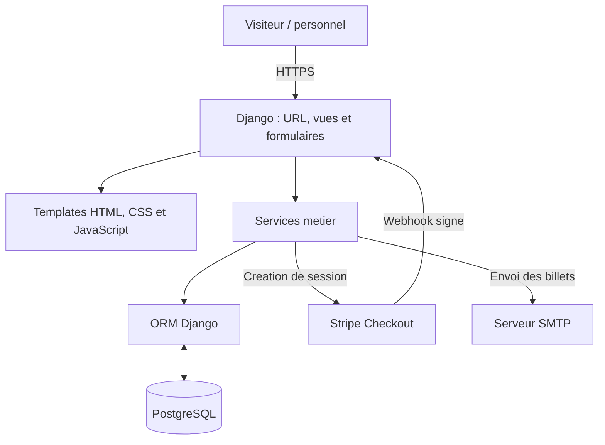

# Architecture technique — Le Grand Cinéma

## Vue d'ensemble

Le Grand Cinéma est une **application web monolithique Django**, organisée en modules métier. Le serveur génère les pages HTML à l'aide des **templates Django** ; l'interface utilise également du CSS (Tailwind) et du JavaScript pour certaines interactions. Il n'y a ni frontend React séparé, ni API REST dédiée au parcours de réservation.

La logique applicative repose sur l'ORM Django et une base **PostgreSQL**. Des services externes interviennent pour le paiement (**Stripe Checkout**) et l'envoi des billets par **e-mail**.

Ce schéma représente les composants applicatifs. La configuration d'infrastructure (Nginx, Gunicorn, HTTPS, serveur VPS) est à détailler séparément dans `docs/deploiement.md`.

## Organisation du code

| Dossier | Responsabilité principale |
|---|---|
| `config/` | Paramètres Django, routage global et point d'entrée WSGI/ASGI. |
| `cinema/` | Films, genres, personnes, salles, places, séances, catalogue et plan de salle. |
| `reservations/` | Sélection de places, réservations provisoires, disponibilités, billets, QR codes, PDF et e-mails. |
| `paiements/` | Démarrage de Stripe Checkout, suivi des paiements et réception des webhooks. |
| `tests/` | Tests Django classés par domaine fonctionnel. |
| `tests-performance/` | Scénarios de charge HTTP k6. |
| `scripts/` | Génération des fixtures de démonstration. |
| `docs/` | Documentation technique du projet. |

Chaque application Django possède ses propres `models.py`, `views.py` et `urls.py` (lorsque nécessaire). Les traitements métier plus complexes sont regroupés dans des fichiers `services.py` afin de ne pas surcharger les vues.

## Traitement d'une requête

1. `config/urls.py` dirige la requête vers l'application concernée.
2. La **vue** contrôle la méthode HTTP, récupère les données et utilise les formulaires ou services nécessaires.
3. Les **services métier** appliquent les règles de gestion et interrogent PostgreSQL via l'ORM.
4. Django renvoie une **page HTML**, une redirection ou une réponse spécifique (PDF, SVG, webhook).

L'authentification repose sur les mécanismes natifs de Django pour l'administration et les opérations réservées au personnel. Les spectateurs peuvent réserver sans créer de compte ; leur réservation provisoire est associée à la session Django.

## Parcours de réservation et de paiement

1. **Consultation** — Le visiteur choisit une séance ; `cinema.views.detail_seance` affiche le plan et les disponibilités calculées par `reservations.services.obtenir_disponibilites`.
2. **Sélection** — `reservations.views.valider_selection` valide les places demandées et présente le récapitulatif.
3. **Réservation provisoire** — `reservations.services.creer_reservation_provisoire` revérifie les disponibilités dans une transaction et enregistre la réservation ainsi que les places associées.
4. **Paiement** — `paiements.services.demarrer_paiement` prépare une tentative et redirige le visiteur vers Stripe Checkout.
5. **Confirmation** — Le webhook Stripe est authentifié par sa signature ; `traiter_session_checkout` vérifie les données du paiement et met à jour la réservation.
6. **Billets** — Après paiement confirmé, un billet est généré pour chaque place. Un e-mail contenant le lien de consultation et les billets PDF est envoyé après validation de la transaction.

Le retour du navigateur depuis Stripe **ne constitue pas, à lui seul, une preuve de paiement** : l'état est vérifié à partir des informations Stripe.

## Modèle de données

Les principales relations sont les suivantes :

- `Film` et `Salle` sont associés à `Seance` ; une salle contient des `Place`.
- `Reservation` est liée à une `Seance` et à plusieurs places par `ReservationPlace`.
- `Paiement` représente une tentative de paiement associée à une réservation.
- `Billet` correspond à une `ReservationPlace` ; `EnvoiBillets` suit l'envoi des billets d'une réservation.

Le détail des champs, contraintes et règles métier figure dans [la documentation du modèle de données](modele-donnees.md), qui doit rester cohérente avec les migrations Django.

## Intégrité des données et sécurité

- **Concurrence** : les opérations critiques utilisent `transaction.atomic()` et `select_for_update()` pour sérialiser les modifications et revérifier les disponibilités avant la création d'une réservation.
- **Disponibilités** : le calcul utilise notamment `Exists` et `OuterRef` pour distinguer les places disponibles, occupées ou inactives, sans les modifier lors de la consultation.
- **Paiement** : signature du webhook vérifiée, cohérence des montants et références contrôlée, et traitement conçu pour supporter les notifications répétées.
- **Billets** : lien personnel signé ; contrôle des billets réservé au personnel autorisé avec les permissions Django.
- **Configuration** : secrets et paramètres de connexion chargés depuis l'environnement ; protections CSRF et cookies sécurisés en configuration de production.

Ces mécanismes limitent certains risques, mais ne remplacent pas les tests ni les mesures de sécurité de l'infrastructure.

## Tests et exploitation

Les tests Django sont organisés par module dans `tests/`. Ruff vérifie la qualité du code ; k6 couvre plusieurs scénarios de consultation HTTP. Voir [les résultats des tests de performance](tests-performance.md).

L'environnement local utilise `python manage.py runserver`. L'architecture et les procédures du déploiement sur VPS (serveur d'applications, reverse proxy, HTTPS, fichiers statiques, sauvegardes et maintenance) seront documentées dans un guide distinct.
