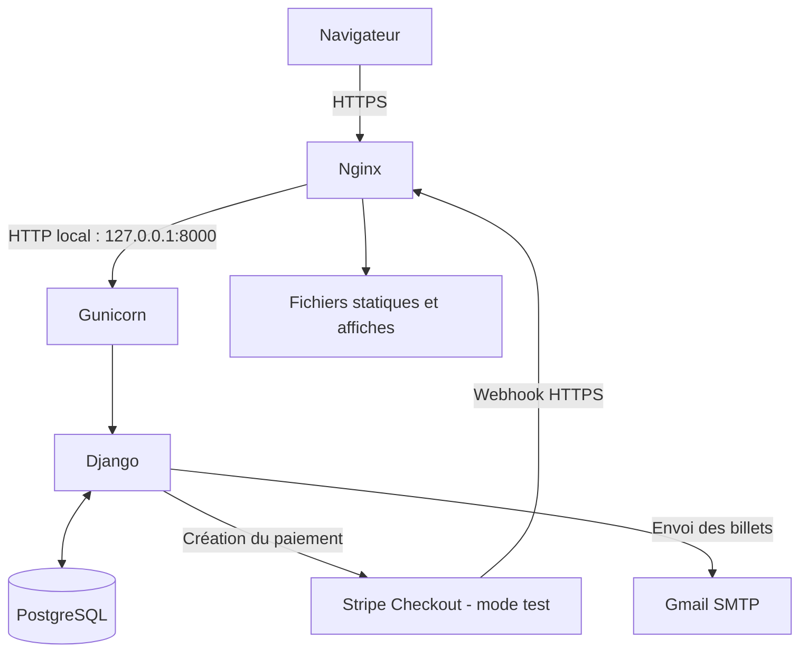

# Documentation technique — Déploiement du Grand Cinéma

Ce document présente l'environnement de déploiement du **Grand Cinéma**, les principaux choix techniques et les procédures d'exploitation mises en place sur le VPS. Il privilégie les opérations concrètes et les configurations utilisées pour le projet.

> **Branche de référence : `main`.** Les procédures Git ci-dessous utilisent exclusivement `main`. Avant de les appliquer, vérifier que cette branche est bien présente sur le VPS et qu'elle contient la version à déployer.

## 1. Environnement de déploiement

L'application est hébergée sur un **VPS IONOS** fonctionnant sous **Ubuntu Server 24.04 LTS**. Elle utilise Django et PostgreSQL, avec **Gunicorn** comme serveur d'application WSGI et **Nginx** comme reverse proxy.

### 1.1 Technologies et versions

| Technologie | Version relevée | Rôle |
|---|---|---|
| Ubuntu Server | 24.04 LTS | Système d'exploitation du VPS |
| Python | 3.12.3 | Exécution de l'application |
| Django | 5.2.18 | Framework web et rendu HTML |
| PostgreSQL | 16.15 (version du client) | Base de données relationnelle |
| Gunicorn | 27.0.0 | Serveur d'application WSGI |
| Nginx | 1.24.0 | Reverse proxy HTTP/HTTPS |

Le déploiement a été réalisé **sans Docker**, à l'aide d'un environnement virtuel Python (`.venv`). Les versions correspondent aux relevés effectués lors de la mise en place ; elles sont susceptibles d'évoluer lors des mises à jour.

### 1.2 Architecture du serveur



Nginx reçoit les connexions HTTPS et transmet les requêtes applicatives à Gunicorn sur l'interface locale. Gunicorn exécute Django, qui accède à PostgreSQL. Les ressources statiques et les affiches sont servies directement par Nginx.

Les services externes utilisés sont **Stripe en mode test** pour les paiements, **Gmail SMTP** pour les e-mails et **Let's Encrypt / Certbot** pour le certificat HTTPS.

## 2. Préparation du VPS et installation de l'application

### 2.1 Accès et sécurisation du serveur

L'administration du VPS s'effectue en **SSH avec une clé d'authentification**. Un pare-feu **UFW** a été mis en place et la connexion SSH directe au compte `root` a été désactivée.

Les paramètres sensibles ne sont pas stockés dans Git : ils sont renseignés dans un fichier `.env` propre au serveur.

### 2.2 Organisation du projet

Le projet est installé dans le répertoire :

```text
/srv/le-grand-cinema/
```

Le code provient du dépôt GitHub. La branche de référence retenue pour le déploiement est **`main`**. Les dépendances Python sont installées dans l'environnement virtuel `.venv`, distinct de l'environnement système.

Les commandes usuelles pour travailler dans cette installation sont :

```bash
cd /srv/le-grand-cinema
source .venv/bin/activate
python --version
```

L'installation initiale du dépôt et de l'environnement virtuel n'est pas reconstituée commande par commande ici : seules les étapes et les chemins confirmés sont documentés.

### 2.3 Configuration Django et PostgreSQL

Django utilise PostgreSQL comme base de données. Les informations de connexion sont fournies via le fichier `.env`, notamment `DB_NAME`, `DB_USER`, `DB_PASSWORD`, `DB_HOST` et `DB_PORT`.

Les principaux paramètres de l'environnement serveur sont :

| Paramètre | Utilisation |
|---|---|
| `DJANGO_DEBUG=False` | Désactivation du mode débogage |
| `DJANGO_ALLOWED_HOSTS` | Autorisation du domaine public |
| `DJANGO_SECRET_KEY` | Clé secrète propre au serveur |
| `SITE_URL` | Adresse HTTPS utilisée dans les liens de l'application |
| `STRIPE_SECRET_KEY`, `STRIPE_WEBHOOK_SECRET` | Intégration Stripe en mode test |
| `EMAIL_*`, `DEFAULT_FROM_EMAIL` | Envoi des e-mails via Gmail SMTP |

Une fois la base configurée, les migrations Django permettent de créer ou de faire évoluer son schéma :

```bash
python manage.py migrate
```

Le projet utilise notamment l'extension PostgreSQL `btree_gist`, nécessaire à certaines contraintes définies dans les migrations. Son installation suppose des droits adaptés sur PostgreSQL.

## 3. Configuration de Gunicorn, Nginx et HTTPS

### 3.1 Gunicorn et `systemd`

Gunicorn exécute l'application Django via son point d'entrée WSGI (`config.wsgi:application`). Il reçoit les requêtes relayées par Nginx sur **`127.0.0.1:8000`**, sans exposition directe de ce port au public.

L'exécution de l'application est gérée par un service Linux `systemd` nommé **`le-grand-cinema`**. Les services essentiels peuvent être contrôlés avec :

```bash
sudo systemctl is-active nginx postgresql le-grand-cinema
```

Lors du contrôle du **11 novembre 2026**, les trois services étaient actifs.

### 3.2 Nginx : reverse proxy et ressources statiques

La configuration du site se trouve dans :

```text
/etc/nginx/sites-available/le-grand-cinema
```

Un lien symbolique dans `/etc/nginx/sites-enabled/` active ce site.

Nginx assure les fonctions suivantes :

- réception des connexions HTTPS sur le port **443** ;
- transmission des requêtes applicatives à Gunicorn ;
- transmission des en-têtes utiles à Django, notamment le protocole HTTPS ;
- distribution des fichiers statiques depuis `/srv/le-grand-cinema/staticfiles/` ;
- distribution des affiches depuis `/srv/le-grand-cinema/media/`, via `/media/`.

Les **billets PDF ne sont pas publiés dans le répertoire des médias** : ils sont générés par Django et accessibles au moyen de liens signés.

### 3.3 Certificat HTTPS

Le domaine utilise un certificat TLS **Let's Encrypt**, configuré à l'aide de **Certbot**.

Les connexions HTTP sont redirigées vers HTTPS avec un code **301**. La commande permettant de simuler le renouvellement d'un certificat, sans en demander un nouveau, est :

```bash
sudo certbot renew --dry-run
```

> Cette commande complète la procédure de contrôle. Son résultat sur le VPS devra être confirmé si l'on souhaite dater explicitement une vérification de renouvellement.

## 4. Services externes

### 4.1 Paiement Stripe

Les paiements sont réalisés avec **Stripe Checkout en mode test**. Après le parcours de paiement, Stripe informe Django du résultat grâce à un **webhook signé**.

La clé secrète Stripe et le secret de signature du webhook sont conservés dans le fichier `.env`, et non dans le dépôt Git.

### 4.2 Envoi des e-mails

L'application utilise **Gmail SMTP** pour transmettre les confirmations et les billets numériques. Les paramètres SMTP et les identifiants sont également renseignés dans le fichier `.env`.

## 5. Procédure de mise à jour depuis `main`

Les nouvelles versions sont déployées **manuellement** depuis GitHub. La branche de référence utilisée dans cette procédure est **`main`**.

### 5.1 Contrôles préalables

Se connecter au VPS par SSH, puis :

```bash
cd /srv/le-grand-cinema
source .venv/bin/activate
git status --short --branch
git fetch origin
git branch --show-current
```

Il faut vérifier l'absence de modifications locales avant de changer de version. Si le dépôt du serveur pointe encore vers une autre branche, basculer explicitement sur `main` :

```bash
git switch main
```

Si `main` n'existe pas encore localement, utiliser à la place :

```bash
git switch --track origin/main
```

Vérifier les commits à récupérer :

```bash
git log --oneline HEAD..origin/main
```

**Avant toute migration pouvant modifier les données**, réaliser une sauvegarde PostgreSQL.

### 5.2 Récupération de la nouvelle version

```bash
git pull --ff-only origin main
```

L'option `--ff-only` interdit la création automatique d'un commit de fusion sur le VPS. En cas de divergence, interrompre la procédure et examiner l'état du dépôt.

### 5.3 Dépendances, migrations et fichiers statiques

```bash
python -m pip install -r requirements.txt
python manage.py migrate
python manage.py collectstatic --noinput
python manage.py check
```

Ces opérations permettent de mettre à jour les dépendances, d'appliquer les migrations, de regrouper les ressources statiques et de vérifier la configuration Django.

### 5.4 Redémarrage du service

Une fois les étapes précédentes terminées sans erreur :

```bash
sudo systemctl restart le-grand-cinema
sudo systemctl is-active le-grand-cinema
```

Le dernier contrôle doit renvoyer `active`.

### 5.5 Vérifications après mise à jour

Tester la réponse HTTPS.

Vérifier ensuite dans le navigateur les fonctionnalités concernées par le déploiement, ainsi que le chargement des fichiers CSS, JavaScript et des affiches.

En cas de problème, consulter les journaux du service :

```bash
sudo journalctl -u le-grand-cinema -n 30 --no-pager
```

## 6. Sauvegardes et maintenance

Les précautions suivantes font partie de l'exploitation du serveur :

- sauvegarde de PostgreSQL avec **`pg_dump`** ;
- vérification d'une restauration sur une **base temporaire** ;
- conservation d'une copie de sauvegarde **hors du VPS** ;
- sauvegarde séparée des fichiers médias, qui ne sont pas stockés dans PostgreSQL ;
- contrôle de l'état des services et consultation des journaux en cas d'incident ;
- suivi des mises à jour de sécurité du système et du renouvellement HTTPS.

Les commandes et emplacements exacts de sauvegarde/restauration ne sont pas détaillés ici, afin de ne pas inventer une procédure qui n'a pas été fournie.

## 7. Bilan et points d'attention

Le déploiement repose sur une infrastructure simple : **un VPS Ubuntu, PostgreSQL, Gunicorn, Nginx et HTTPS**, sans conteneur ni plateforme d'orchestration. Cette organisation permet de gérer directement le fonctionnement, les mises à jour et la supervision de l'application.

Quelques limites restent à connaître :

- La procédure de mise à jour est **manuelle** : aucun pipeline CI/CD de déploiement n'est décrit.
- Le VPS doit posséder une version de `main` contenant les changements attendus avant de lancer la mise à jour.
- Les migrations de base de données ne sont pas automatiquement annulées lors d'un retour à une ancienne version du code.
- **Gunicorn est installé sur le VPS**, mais n'apparaît pas dans le `requirements.txt` de l'archive analysée : sa gestion comme dépendance de déploiement reste à formaliser.
- Les tests de charge **k6** effectués localement avec `runserver` ne représentent pas une mesure de capacité du VPS en production.

Cette documentation est destinée à retracer la mise en place et l'exploitation du projet. Les fichiers réels de configuration Nginx et `systemd`, non présents dans le dépôt analysé, pourront être ajoutés en annexe si nécessaire, après suppression de toute information sensible.
