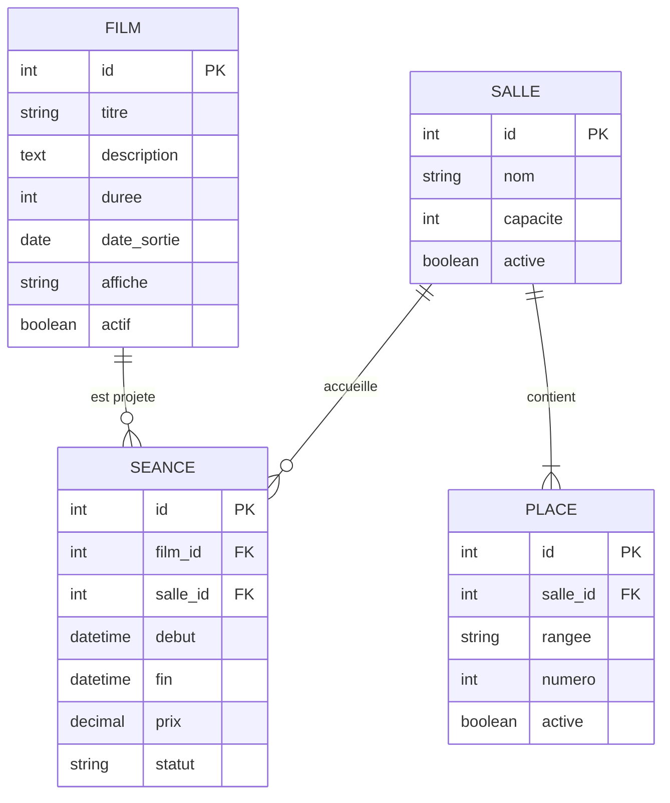

# Modélisation des données — Le Grand Cinéma

## 1. Objectif

Ce document présente la modélisation des données de l'application web **Le Grand Cinéma**, développée dans le cadre de l'évaluation du Bloc 3 du Bachelor Développeur Concepteur d'Applications Python.

L'objectif est de définir la structure des données nécessaires au fonctionnement de l'application, les relations entre les différentes entités et les principales règles de gestion.

Cette modélisation servira de référence pour l'implémentation des modèles Django et la création des tables PostgreSQL au moyen des migrations.

Le modèle sera progressivement complété en fonction des besoins métier définis dans les blocs 1 et 2.

## 2. Choix de modélisation

Le projet utilise une base de données relationnelle PostgreSQL, associée à l'ORM de Django.

Les données sont organisées autour des principales fonctionnalités de l'application :

- Gestion des films et de la programmation.
- Gestion des salles et des places.
- Réservation de places par les spectateurs.
- Paiement sécurisé des réservations.
- Génération et consultation des billets numériques.
- Administration de la plateforme.

Les utilisateurs administrateurs seront gérés par le système d'authentification intégré à Django.

La création d'un compte spectateur ne sera pas obligatoire dans la première version de l'application (MVP).

## 3. Description des entités

### 3.1. Film

L'entité `Film` représente un film proposé dans la programmation du cinéma.

| Attribut | Type envisagé | Description |
|---|---|---|
| `id` | Identifiant | Clé primaire |
| `titre` | VARCHAR(200) | Titre du film |
| `description` | TEXT | Synopsis |
| `duree` | INTEGER | Durée en minutes |
| `date_sortie` | DATE | Date de sortie |
| `affiche` | VARCHAR(255) | Chemin de l'affiche |
| `actif` | BOOLEAN | Présence dans le catalogue |

**Règles de gestion :**

- Un film peut être associé à plusieurs séances.
- Chaque séance concerne un seul film.
- Un film désactivé peut être conservé dans la base pour préserver l'historique de la programmation.

### 3.2. Salle

L'entité `Salle` représente une salle physique du cinéma.

| Attribut | Type envisagé | Description |
|---|---|---|
| `id` | Identifiant | Clé primaire |
| `nom` | VARCHAR(100) | Nom ou numéro de salle |
| `capacite` | INTEGER | Capacité maximale |
| `active` | BOOLEAN | État de disponibilité de la salle |

**Règles de gestion :**

- Une salle peut accueillir plusieurs séances à des horaires différents.
- Une salle contient plusieurs places physiques.
- Deux séances ne doivent pas se chevaucher dans une même salle.
- La capacité renseignée doit rester cohérente avec le nombre de places enregistrées.

### 3.3. Place

L'entité `Place` représente une place physique située dans une salle.

| Attribut | Type envisagé | Description |
|---|---|---|
| `id` | Identifiant | Clé primaire |
| `salle_id` | Clé étrangère | Salle associée |
| `rangee` | VARCHAR(5) | Rangée de la place |
| `numero` | INTEGER | Numéro de la place |
| `active` | BOOLEAN | Place utilisable ou non |

**Règles de gestion :**

- Une place appartient à une seule salle.
- Une salle peut contenir plusieurs places.
- Une place est identifiée de manière unique par sa rangée et son numéro au sein d'une salle.
- La disponibilité d'une place pour une séance dépend des réservations existantes, et non uniquement de son état `active`.

Une contrainte d'unicité sera prévue sur les champs `salle_id`, `rangee` et `numero`.

### 3.4. Séance

L'entité `Seance` représente la projection d'un film dans une salle, à une date et une heure déterminées.

| Attribut | Type envisagé | Description |
|---|---|---|
| `id` | Identifiant | Clé primaire |
| `film_id` | Clé étrangère | Film projeté |
| `salle_id` | Clé étrangère | Salle utilisée |
| `debut` | DATETIME | Date et heure de début |
| `fin` | DATETIME | Date et heure de fin |
| `prix` | DECIMAL(8,2) | Tarif de référence |
| `statut` | VARCHAR(20) | Programmée, annulée ou terminée |

**Règles de gestion :**

- Une séance concerne un seul film.
- Une séance se déroule dans une seule salle.
- Une salle ne peut pas accueillir deux séances dont les horaires se chevauchent.
- La date de fin doit être postérieure à la date de début.
- Une séance annulée ne doit plus accepter de nouvelles réservations.

## 4. Relations entre les entités

Les premières relations identifiées sont les suivantes :

| Relation | Cardinalités |
|---|---|
| Film — Séance | Un film peut avoir 0 à N séances ; une séance concerne 1 film |
| Salle — Séance | Une salle peut accueillir 0 à N séances ; une séance utilise 1 salle |
| Salle — Place | Une salle contient 1 à N places ; une place appartient à 1 salle |

## 5. Diagramme du modèle de données

Le diagramme suivant représente les quatre premières entités et leurs relations.

Ce diagramme constitue une première représentation du modèle de données. Il sera enrichi avec les entités liées aux réservations, aux paiements et à la billetterie.

## 6. Évolutions prévues

Les prochaines étapes de modélisation concerneront :

- `Reservation` : suivi des réservations et de leur expiration.
- `ReservationPlace` : association entre une réservation et les places sélectionnées.
- `Paiement` : suivi des opérations réalisées avec Stripe Checkout.
- `Billet` : gestion des billets numériques.

Une attention particulière sera portée à la prévention des doubles réservations et au traitement des paiements concurrents ou tardifs.

Le modèle complet sera validé avant l'implémentation des modèles Django correspondants.