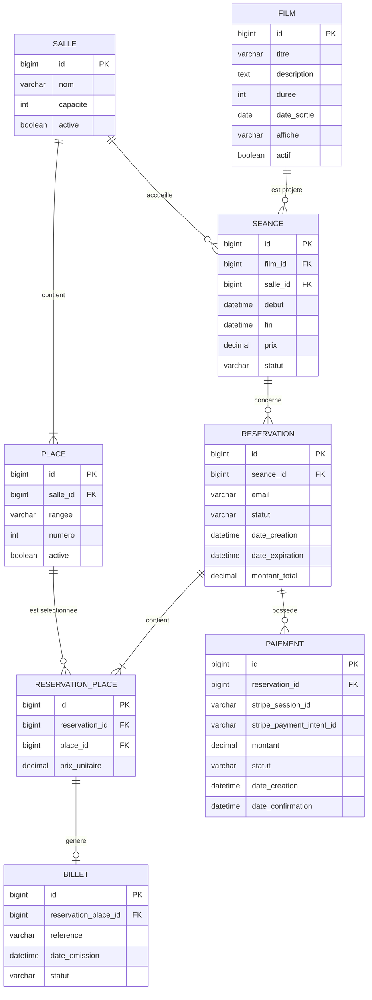

# Modélisation des données — Le Grand Cinéma

## 1. Objectif

Ce document présente la modélisation des données de l'application web **Le Grand Cinéma**, développée dans le cadre de
l'évaluation du Bloc 3 du Bachelor Développeur Concepteur d'Applications Python.

L'objectif est de définir les entités nécessaires au fonctionnement de l'application, leurs attributs, leurs relations
ainsi que les principales règles de gestion.

Cette modélisation servira de référence pour l'implémentation des modèles Django et la création des tables PostgreSQL au
moyen des migrations.

Elle s'appuie sur les besoins fonctionnels définis dans les blocs 1 et 2, en privilégiant une structure cohérente,
maintenable et adaptée au périmètre du MVP.

## 2. Choix de modélisation

Le projet utilise une base de données relationnelle **PostgreSQL**, associée à l'ORM de Django.

Les données sont organisées autour des principales fonctionnalités de l'application :

- Gestion des films et de la programmation.
- Gestion des salles et des places.
- Consultation des disponibilités.
- Réservation de places par les spectateurs.
- Paiement sécurisé des réservations.
- Génération et consultation des billets numériques.
- Administration de la plateforme.

Le modèle repose sur huit entités métier principales :

| Entité             | Responsabilité                           |
|--------------------|------------------------------------------|
| `Film`             | Informations relatives aux films         |
| `Salle`            | Organisation des salles du cinéma        |
| `Place`            | Identification des places physiques      |
| `Seance`           | Programmation des projections            |
| `Reservation`      | Enregistrement et suivi des réservations |
| `ReservationPlace` | Association des places aux réservations  |
| `Paiement`         | Suivi des transactions Stripe            |
| `Billet`           | Gestion des billets dématérialisés       |

Les comptes du personnel administratif seront gérés avec le système d'authentification intégré à Django.

La création d'un compte spectateur ne sera pas obligatoire dans le MVP. Les coordonnées nécessaires seront directement
associées aux réservations.

## 3. Description des entités

Les types présentés correspondent aux types de données envisagés dans PostgreSQL. Leur implémentation sera réalisée à
l'aide des champs adaptés de l'ORM Django.

### 3.1. Film

L'entité `Film` représente un film proposé dans la programmation du cinéma.

| Attribut      | Type envisagé | Description                |
|---------------|---------------|----------------------------|
| `id`          | BIGINT        | Clé primaire               |
| `titre`       | VARCHAR(200)  | Titre du film              |
| `description` | TEXT          | Synopsis                   |
| `duree`       | INTEGER       | Durée en minutes           |
| `date_sortie` | DATE          | Date de sortie             |
| `affiche`     | VARCHAR(255)  | Chemin vers l'affiche      |
| `actif`       | BOOLEAN       | Présence dans le catalogue |

**Règles de gestion :**

- Un film peut être associé à plusieurs séances.
- Chaque séance concerne un seul film.
- La durée d'un film doit être strictement positive.
- Un film désactivé peut être conservé afin de préserver l'historique de la programmation.

### 3.2. Salle

L'entité `Salle` représente une salle physique du cinéma.

| Attribut   | Type envisagé | Description                    |
|------------|---------------|--------------------------------|
| `id`       | BIGINT        | Clé primaire                   |
| `nom`      | VARCHAR(100)  | Nom ou numéro de salle         |
| `capacite` | INTEGER       | Capacité maximale              |
| `active`   | BOOLEAN       | État d'utilisation de la salle |

**Règles de gestion :**

- Une salle peut accueillir plusieurs séances à des horaires différents.
- Une salle contient plusieurs places physiques.
- Deux séances ne doivent pas se chevaucher dans une même salle.
- Le nom d'une salle doit être unique.
- La capacité doit être strictement positive et cohérente avec le nombre de places enregistrées.

La capacité pourra être contrôlée à partir des places effectivement enregistrées. Une attention particulière sera portée
à la cohérence entre la capacité déclarée et le plan de salle.

### 3.3. Place

L'entité `Place` représente une place physique située dans une salle.

| Attribut   | Type envisagé | Description                |
|------------|---------------|----------------------------|
| `id`       | BIGINT        | Clé primaire               |
| `salle_id` | BIGINT        | Clé étrangère vers `Salle` |
| `rangee`   | VARCHAR(5)    | Rangée de la place         |
| `numero`   | INTEGER       | Numéro de la place         |
| `active`   | BOOLEAN       | Place utilisable ou non    |

**Règles de gestion :**

- Une place appartient à une seule salle.
- Une place est identifiée par sa rangée et son numéro au sein d'une salle.
- Le numéro d'une place doit être strictement positif.
- Une place désactivée ne peut pas être sélectionnée pour une nouvelle réservation.
- La disponibilité d'une place pour une séance dépend des réservations existantes.

Une contrainte d'unicité sera définie sur le triplet `(salle_id, rangee, numero)`.

Le champ `active` représente l'état physique ou administratif de la place. Il ne doit pas être confondu avec sa
disponibilité pour une séance particulière.

### 3.4. Séance

L'entité `Seance` représente la projection d'un film dans une salle à une date et une heure déterminées.

| Attribut   | Type envisagé            | Description                     |
|------------|--------------------------|---------------------------------|
| `id`       | BIGINT                   | Clé primaire                    |
| `film_id`  | BIGINT                   | Clé étrangère vers `Film`       |
| `salle_id` | BIGINT                   | Clé étrangère vers `Salle`      |
| `debut`    | TIMESTAMP WITH TIME ZONE | Date et heure de début          |
| `fin`      | TIMESTAMP WITH TIME ZONE | Date et heure de fin            |
| `prix`     | DECIMAL(8,2)             | Tarif de référence              |
| `statut`   | VARCHAR(20)              | Programmée, annulée ou terminée |

**Règles de gestion :**

- Une séance concerne un seul film.
- Une séance se déroule dans une seule salle.
- La date de fin doit être postérieure à la date de début.
- Le prix ne peut pas être négatif.
- Deux séances ne doivent pas se chevaucher dans une même salle.
- Une séance annulée ou terminée ne peut plus accepter de nouvelles réservations.
- Une séance ne doit pas être programmée dans une salle inactive.

Le contrôle des chevauchements devra être effectué lors de la création ou de la modification d'une séance. Une
contrainte PostgreSQL adaptée pourra également être étudiée si le besoin l'exige.

### 3.5. Réservation

L'entité `Reservation` représente une réservation effectuée par un spectateur pour une séance.

| Attribut          | Type envisagé            | Description                      |
|-------------------|--------------------------|----------------------------------|
| `id`              | BIGINT                   | Clé primaire                     |
| `seance_id`       | BIGINT                   | Clé étrangère vers `Seance`      |
| `email`           | VARCHAR(254)             | Adresse e-mail du spectateur     |
| `statut`          | VARCHAR(20)              | État de la réservation           |
| `date_creation`   | TIMESTAMP WITH TIME ZONE | Date de création                 |
| `date_expiration` | TIMESTAMP WITH TIME ZONE | Expiration du blocage provisoire |
| `montant_total`   | DECIMAL(8,2)             | Montant total de la réservation  |

Les statuts envisagés sont :

| Statut       | Signification                                          |
|--------------|--------------------------------------------------------|
| `en_attente` | Places temporairement réservées, paiement non confirmé |
| `confirmee`  | Réservation validée après confirmation du paiement     |
| `expiree`    | Délai de réservation provisoire dépassé                |
| `annulee`    | Réservation annulée                                    |

**Règles de gestion :**

- Une réservation concerne une seule séance.
- Une réservation contient une ou plusieurs places.
- Une réservation peut être effectuée sans compte spectateur.
- Une adresse e-mail valide est nécessaire pour permettre la récupération du billet.
- Une réservation provisoire possède une date d'expiration.
- Une réservation expirée ou annulée ne doit plus bloquer les places.
- Le montant total correspond à la somme des prix appliqués aux places réservées.

La réservation ne pourra être confirmée qu'après vérification du paiement et de la disponibilité effective des places.

### 3.6. ReservationPlace

L'entité `ReservationPlace` représente l'association entre une réservation et une place physique.

Elle permet de gérer plusieurs places au sein d'une même réservation.

| Attribut         | Type envisagé | Description                      |
|------------------|---------------|----------------------------------|
| `id`             | BIGINT        | Clé primaire                     |
| `reservation_id` | BIGINT        | Clé étrangère vers `Reservation` |
| `place_id`       | BIGINT        | Clé étrangère vers `Place`       |
| `prix_unitaire`  | DECIMAL(8,2)  | Prix appliqué à cette place      |

**Règles de gestion :**

- Une réservation contient une ou plusieurs associations `ReservationPlace`.
- Chaque association concerne une seule place.
- Une place physique peut être associée à plusieurs réservations portant sur des séances différentes.
- Une même place ne doit pas être ajoutée deux fois à une réservation.
- La place sélectionnée doit appartenir à la salle de la séance réservée.
- Le prix unitaire doit être positif ou nul.

Une contrainte d'unicité sera définie sur `(reservation_id, place_id)` afin d'éviter les doublons au sein d'une même
réservation.

La prévention des doubles réservations pour une même séance nécessitera des contrôles supplémentaires, décrits dans la
section 6.

### 3.7. Paiement

L'entité `Paiement` représente une tentative de paiement associée à une réservation.

Le traitement bancaire sera délégué à Stripe Checkout.

| Attribut                   | Type envisagé            | Description                                 |
|----------------------------|--------------------------|---------------------------------------------|
| `id`                       | BIGINT                   | Clé primaire                                |
| `reservation_id`           | BIGINT                   | Clé étrangère vers `Reservation`            |
| `stripe_session_id`        | VARCHAR(255)             | Identifiant de session Stripe               |
| `stripe_payment_intent_id` | VARCHAR(255)             | Référence du paiement Stripe, si disponible |
| `montant`                  | DECIMAL(8,2)             | Montant concerné                            |
| `statut`                   | VARCHAR(20)              | État du paiement                            |
| `date_creation`            | TIMESTAMP WITH TIME ZONE | Date de création                            |
| `date_confirmation`        | TIMESTAMP WITH TIME ZONE | Date de confirmation, si applicable         |

Les statuts envisagés sont :

| Statut       | Signification                |
|--------------|------------------------------|
| `en_attente` | Paiement initié              |
| `reussi`     | Paiement confirmé par Stripe |
| `echoue`     | Paiement non abouti          |
| `rembourse`  | Paiement remboursé           |

**Règles de gestion :**

- Un paiement est associé à une seule réservation.
- Une réservation peut être associée à plusieurs tentatives de paiement.
- Chaque identifiant de session Stripe doit être unique.
- Le montant ne peut pas être négatif.
- Aucune donnée bancaire sensible ne doit être stockée dans l'application.
- La confirmation du paiement repose sur les événements vérifiés transmis par Stripe.

Le traitement des webhooks devra être idempotent afin qu'une notification reçue plusieurs fois ne provoque pas de
traitement en double.

Si nécessaire, une table technique complémentaire pourra conserver les identifiants uniques des événements Stripe déjà
traités. Elle sera précisée lors de l'implémentation du module de paiement.

### 3.8. Billet

L'entité `Billet` représente un billet numérique émis pour une place réservée.

| Attribut               | Type envisagé            | Description                           |
|------------------------|--------------------------|---------------------------------------|
| `id`                   | BIGINT                   | Clé primaire                          |
| `reservation_place_id` | BIGINT                   | Clé étrangère vers `ReservationPlace` |
| `reference`            | VARCHAR(100)             | Référence publique unique du billet   |
| `date_emission`        | TIMESTAMP WITH TIME ZONE | Date de génération                    |
| `statut`               | VARCHAR(20)              | État du billet                        |

Les statuts envisagés sont :

| Statut   | Signification     |
|----------|-------------------|
| `valide` | Billet utilisable |
| `annule` | Billet invalidé   |

**Règles de gestion :**

- Un billet correspond à une seule place associée à une réservation.
- Une association `ReservationPlace` ne peut produire qu'un seul billet.
- Un billet valide ne peut être généré que pour une réservation confirmée.
- Chaque billet possède une référence unique.
- Le billet doit permettre d'identifier le film, la séance, la salle et la place correspondante.

Les billets pourront être générés au format PDF et éventuellement comporter un QR code.

Le contenu du document sera produit à partir des informations de réservation et des données associées, afin d'éviter de
dupliquer inutilement ces informations dans la table `Billet`.

## 4. Relations et cardinalités

Les relations entre les entités sont définies comme suit :

| Relation                       | Cardinalités                                                                                                       |
|--------------------------------|--------------------------------------------------------------------------------------------------------------------|
| Film — Séance                  | Un film possède 0 à N séances ; une séance concerne exactement 1 film                                              |
| Salle — Séance                 | Une salle accueille 0 à N séances ; une séance utilise exactement 1 salle                                          |
| Salle — Place                  | Une salle contient 1 à N places ; une place appartient exactement à 1 salle                                        |
| Séance — Réservation           | Une séance possède 0 à N réservations ; une réservation concerne exactement 1 séance                               |
| Réservation — ReservationPlace | Une réservation validée contient 1 à N places ; une association appartient exactement à 1 réservation              |
| Place — ReservationPlace       | Une place peut apparaître dans 0 à N associations au fil des séances ; une association concerne exactement 1 place |
| Réservation — Paiement         | Une réservation possède 0 à N tentatives de paiement ; un paiement concerne exactement 1 réservation               |
| ReservationPlace — Billet      | Une association possède 0 ou 1 billet ; un billet concerne exactement 1 association                                |

La contrainte imposant au moins une place dans une réservation sera vérifiée par la logique métier au moment de la
création. Elle n'est pas garantie par la seule présence des clés étrangères.

## 5. Diagramme global des données

Le diagramme suivant présente les huit entités principales, leurs attributs ainsi que leurs relations.

Il correspond à une représentation logique simplifiée, proche d'un diagramme entité-association, intégrant les clés
primaires et étrangères.

Les cardinalités représentent les relations métier attendues. Certaines règles, comme l'obligation pour une réservation
de contenir au moins une place ou l'interdiction des réservations concurrentes, seront garanties par des contrôles
applicatifs et transactionnels complémentaires.

## 6. Contraintes d'intégrité

Plusieurs contraintes devront garantir la cohérence des données :

- **Unicité des places :** une même salle ne peut pas contenir deux places possédant la même rangée et le même numéro.
- **Intégrité référentielle :** les relations entre les entités seront garanties par des clés étrangères.
- **Cohérence des séances :** une séance doit posséder une date de fin postérieure à sa date de début et ne doit pas
  chevaucher une autre séance dans la même salle.
- **Réservations :** une place ne peut pas être attribuée à plusieurs réservations actives pour une même séance.
- **Billetterie :** un billet ne peut être associé qu'à une seule place réservée, et ne peut être valide que si la
  réservation est confirmée.
- **Paiements :** les identifiants de sessions Stripe devront être uniques afin d'éviter les doublons.

Certaines contraintes seront appliquées directement au niveau PostgreSQL, tandis que d'autres nécessiteront des
contrôles dans la logique métier Django, notamment pour les réservations concurrentes.